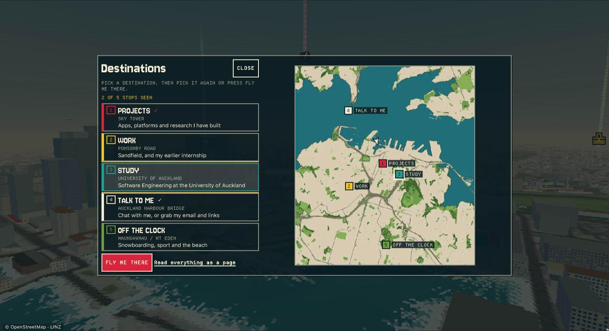
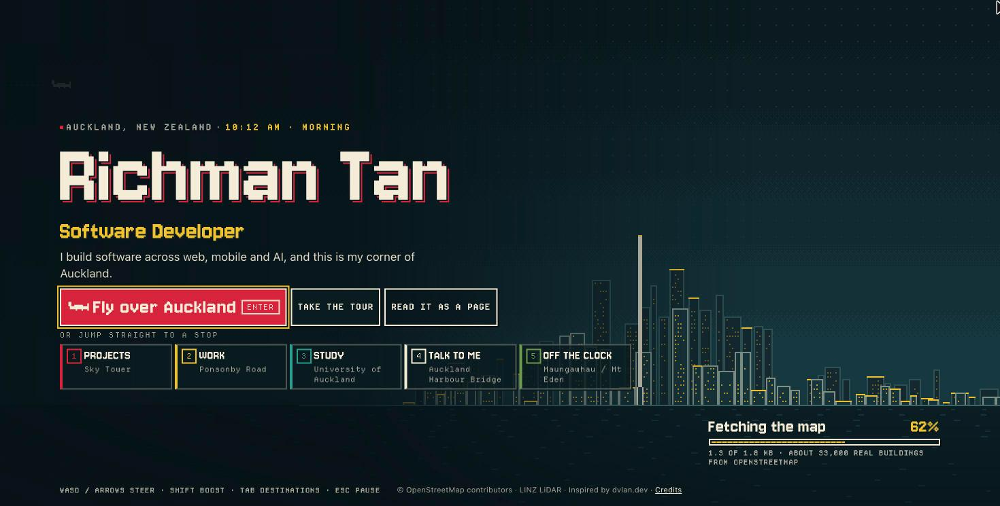

# auckland-world

[](https://github.com/Richman-Tan/auckland-world/actions/workflows/ci.yml)
[](https://github.com/Richman-Tan/auckland-world/releases)

**Live at [richmantan.dev](https://richmantan.dev/).** Richman Tan's portfolio as a little flight over real central Auckland. Fly a pixel plane to the beacons for projects, work, study and the rest, land inside the Sky Tower, chat on the Harbour Bridge, or read it all as a plain page at [`/page/`](https://richmantan.dev/page/).

[](https://richmantan.dev/)

The city is real: about 33,000 buildings from OpenStreetMap on terrain from LINZ's 1 m LiDAR survey, 7.2 by 8 km, packed into about 2.4 MB of map data (1.8 MB of it needed before the city is shown) and drawn at low resolution with dithered, toon-stepped shaders. There is no framework and no game engine, just TypeScript, [three.js](https://threejs.org/) and Vite. The title screen is interactive after 35 KB of gzipped JavaScript; three.js and the map load behind it.

Concept inspired by [dvlan.dev](https://dvlan.dev). All code, art and copy here are original.

## What you can do

- **Fly.** A small flight model with boost, a chase camera, a cockpit HUD with radar and compass, and collisions with every building, the Sky Tower and the Harbour Bridge.
- **Take the tour.** One button flies you to each of the five stops in turn on autopilot. Stops you have seen are remembered and ticked off.
- **Read.** Each stop opens a paged briefing beside its landmark. Every stop, page and room has its own link, and the browser's Back button works.
- **Land.** At the Sky Tower you can walk around the Sky Deck, where screens play short clips of each project.
- **Talk.** The stop on the Harbour Bridge is a chat: scripted answers for the suggested questions, Claude for anything you type, grounded only in the site's own content.
- **Watch the city.** The light follows the real time of day in Auckland. At night the windows come on and the Sky Tower is floodlit. Ferries cross the harbour and traffic runs over the bridge.
- **Wait well.** The title is on screen before any script runs, and while the map loads a blueprint of the skyline goes up with it.
- **Or skip all of it.** [`/page/`](https://richmantan.dev/page/) is the same content as one static page with no JavaScript, and it is where you land without WebGL.

<table>
<tr>
<td width="50%"><br><sub>Over the Viaduct, heading for the Sky Tower.</sub></td>
<td width="50%"><br><sub>A briefing opens beside its landmark while the plane holds a circle.</sub></td>
</tr>
<tr>
<td><br><sub>Night, on the real Auckland clock or with <code>?time=night</code>.</sub></td>
<td><br><sub>The chat on the Harbour Bridge at dusk, with traffic on the deck.</sub></td>
</tr>
<tr>
<td><br><sub>Inside the Sky Deck. The windows look out on the same city.</sub></td>
<td><br><sub>The destinations map, with the stops already seen ticked off.</sub></td>
</tr>
</table>

## Controls

| | Keyboard | Gamepad | Touch |
|---|---|---|---|
| Steer and pitch | W A S D or arrows, or drag with the mouse | Left stick | Stick, bottom left |
| Boost | Shift | RT or RB | BOOST |
| Read or talk at a beacon | Space | A | READ, or the prompt |
| Land at the Sky Tower, use what you face | E | X | The prompt |
| Destinations map | Tab or M | Y | MAP |
| Pick a stop, then fly there | 1 to 5, then Enter | D-pad, then A | Tap it twice |
| Page through a briefing | Left and right, or A and D | D-pad | Buttons |
| Next stop, from a briefing | N | LB | Button |
| Back | Esc | B | Buttons |
| Pause menu and settings | Esc while flying | Start | MENU |

The settings (graphics, time of day, sound, pitch direction, reduced motion) are in the pause menu.

## Links and parameters

| Address | Opens |
|---|---|
| `/?stop=projects` | A stop's briefing. Stops: `projects`, `work`, `study`, `talk`, `offclock`. |
| `/?stop=projects&page=wie-academy` | One page of it. |
| `/?stop=projects&room=skydeck` | Inside the Sky Deck. |
| `/?time=dusk` | A time of day: `morning`, `afternoon`, `dusk`, `night`, or a solar hour such as `22`. |
| `/?quality=low` | The lighter map tier (`low` or `high`) for this visit. |
| `/?map=fake` | The synthetic test map instead of Auckland. |
| `/?debug` | `window.__aw`: state, teleports, frame statistics. |

## Run it

```sh
nvm use               # Node 22
npm install
npm run dev           # http://localhost:5173
npm run typecheck     # src, scripts, api and the dev harnesses
npm test              # about 300 tests, a few seconds
npm run build         # typecheck, tests, then vite build (this is what Vercel runs)
npm run check:bundle  # after a build: the title page and /page/ load no three.js up front, and stay in budget
npm run cv:web -- ~/Documents/cv/cv.tex   # rebuild the public copy of the CV (needs LaTeX)
```

`npm run dev` has no chat API, so the chat is scripted locally. The built map is committed in `public/map/`, so nothing needs fetching to run the site. To rebuild it:

```sh
npm run map:fake   # the synthetic world in public/map-fake (no network)
npm run map        # fetch (cached in data/), build public/map, check
```

## Testing and deploying

GitHub Actions (`.github/workflows/ci.yml`) runs the typecheck, the tests, a build and the bundle check on every push to `master` and every pull request. The tests are plain Vitest in Node: the flight model, the autopilot flown headless to every stop on the real map, the state machine, routing, the content rules, the chat server and the map pipeline. There are no browser tests; the dev harnesses in `dev/*.html` are for looking at things by hand.

The Vercel project is connected to this repository: a push to `master` builds and deploys to production, and other branches and pull requests get preview deployments. Vercel builds with `npm run build`, so a type error or a failing test stops the deploy and the site stays on the last good build. `vercel --prod` from a clean checkout still works for a manual deploy.

Node is pinned to 22 in three places that must agree: `.nvmrc` (local, and what CI reads), and `engines` in `package.json` (what Vercel reads).

Set `ANTHROPIC_API_KEY` in the Vercel project for the AI chat; without it the chat stays scripted.

## How it works

`docs/PLAN.md` is the original design and milestones, kept as a record. This README describes the code as it is. `ATTRIBUTION.md` has the data licences.

### Layout

- `src/app/` state machine, contracts, stop placement, routing, progress, settings, the frame-rate governor and the app loop (`app.ts`)
- `src/world/`, `src/render/` map loading, worker extrusion, low-res renderer, terrain, water, landmarks, beacons, ambient traffic
- `src/audio/` the synthesised sound, loaded on demand
- `src/flight/`, `src/input/` flight model, autopilot, orbit, proximity, chase camera, plane, keyboard, mouse, touch and gamepad
- `src/ui/` title, HUD, nav, briefing, chat, warp, pause and error views
- `src/room/` the Sky Deck: layout and hotspots, walking, and the runtime (screens, signs, first-person camera); the room's mesh is `src/world/landmarks/skyDeck.ts`
- `src/chat/` bridge chat: scripted matching, the AI backend (`remote.ts`), the `/api/chat` handler and its system prompt
- `api/chat.ts` Vercel Node.js function for the AI chat; `api/_site.ts` is its generated prompt (`npm run chat:site`)
- `scripts/icon/build.ts` the site icon (the initials in the title's style, on a 16 x 16 grid); `npm run icon` rewrites `public/favicon.svg` and the two PNGs
- `src/content/` everything the site says (one source for the 3D view, `/page/` and the chat prompt), and `rules.ts`, what it never says
- `src/shared/` binary map formats, collision, the Harbour Bridge's shape (`bridge.ts`, read by its model, its colliders and its traffic alike), palette, time of day, detail ladder and ambient paths (pure; shared by the pipeline, the runtime and the tests)
- `scripts/` map pipeline (fetch, build, check), the synthetic map generator, and the public CV build (`scripts/cv/`)
- `dev/*.html` dev-only harnesses for the world, flight, UI and the social card (`dev/og.html`)

### First paint, loading and the reveal

The title screen is in `index.html` itself. The build prerenders it from the content (`titleHtml` in `src/ui/views/titleHtml.ts`, written in by `scripts/vite/pagePrerender.ts`), so the name, the pitch and every button are painted from the first response, with no script. When the script arrives it takes over those same elements (`src/ui/views/title.ts`) rather than drawing new ones, and the buttons, dim until then, light up in turn. "Read it as a page" is a plain link and works from the start.

- **No jump.** The two typefaces are preloaded, and the display face waits rather than showing the name in a stand-in. A few lines in the head set the pixel scale before the first paint, by the same rule the renderer uses later (`src/shared/pixelScale.ts`; a test holds the two together).
- **Loading.** Behind the title is the boot scene (`src/ui/boot/`): a blueprint of the skyline on a small 2D canvas that goes up as the map arrives, with the Sky Tower as the gauge. Its mast is finished when the load is. The loader beside it gives the stage in words, a percentage and the megabytes. The download reports real bytes and takes most of the bar; building the geometry and compiling the shaders report nothing of their own, so the bar holds at a mark for each instead of pretending to move (`src/ui/loadStage.ts`).
- **The reveal.** Once the live city has really been drawn, the blueprint dissolves away from the Sky Tower outwards in an ordered dither, and the title camera eases in from high and wide. With reduced motion it is a cut, and the camera does not move.
- **Never a gate.** Every button works while the map loads: flying early goes to the loading view over the same scene. A link straight to a stop skips the title from the first paint. If the map fails, the loader says so and points at the page version.



Beside the place name the title shows the time in Auckland and the part of the day, because that is what the city is lit for; it hides when a fixed time of day is chosen.

### Tour, progress and links

- **Tour.** "Take the tour" on the title screen loads the world and flies to the first stop on autopilot. Every briefing and the chat then offer "Next stop" (N in a briefing), which flies to the next stop not yet seen, in `TOUR_ORDER` (`src/app/progress.ts`), ending at the chat.
- **Progress.** Opening a stop's briefing, chat or room marks it seen. The set is kept in `localStorage` (`aw:progress:v1`) and shown as ticks on the title and the destinations map; the site works the same with storage blocked.
- **Links.** The address follows what is open (`src/app/route.ts`). Moving to another stop adds a history entry and a page turn rewrites the current one, so the browser's Back and Forward walk the visit a stop at a time (cutting to the stop rather than flying). "Copy link" in a briefing copies the address, and without WebGL the same link leads to that spot on `/page/`.

### A living city

- **Time of day** (`src/shared/timeOfDay.ts`). The sky, the three steps of light, fog, water, window lights and stars all come from one `Look`, blended between keyframes on a solar clock where 6 is sunrise, 12 noon and 18 sunset. On Auto the real wall-clock time in Auckland is mapped onto that clock using the day's sunrise and sunset, so it is light at 8 pm in December and dark by 6 in June. The settings can pin Morning, Afternoon, Dusk or Night, and `?time=` takes a solar hour or one of those names. Afternoon is the look the site was first drawn in, and a test holds it to those colours.
- **At night** about half of each tower's windows are lit, the Sky Tower's pod and mast are floodlit (faces marked with `ALPHA_FLOOD` or `ALPHA_WINDOW` in `src/world/landmarks/builder.ts`), the Sky Deck is lit from inside, and traffic shows head and tail lights.
- **Ambient traffic** (`src/world/ambient.ts`, paths in `src/shared/ambientPaths.ts`): ferries on the Devonport and Bayswater runs, a boat that passes under the Harbour Bridge's main span, and cars on the bridge keeping left. Two instanced meshes, so two draw calls. A ferry route is only used if every point along it is over water on the loaded map, which is why the synthetic map gets no boats sailing over land. None of it can be hit.
- **Sound** (`src/audio/index.ts`) is off until switched on, from the HUD or the settings. It is synthesised with Web Audio (an engine note and wind that follow the airspeed, a room hum on the Sky Deck, a few short cues), so there are no audio files; the module is its own chunk, fetched on first use.
- `dev/world.html?map=real&view=bridge&time=18` previews any hour; `[` and `]` scrub half an hour at a time.

### Roads, and detail that loads after the city

From the air the roads are paint in the ground image, at three metres a pixel. Near the plane they are geometry: every road and railway within about 700 m is a ribbon lying on the terrain, and its material (`createRibbonMaterial`) paints the seal with its patches, kerbs and jointed footpaths, edge lines, centre lines and lane dashes, rail with its sleepers, and at night the pools of light under the lamps of main roads. Lanes come from OpenStreetMap where recorded and from the road's class where not (`src/shared/roads.ts`).

- **The data** is `roads.bin.gz` (118 KB: 10,430 ways, 807 km), written by the `roads` stage of the pipeline from the same roads the ground image paints. The roadway on the Harbour Bridge is left out; its deck is modelled on its own.
- **It loads after the first view.** `WorldScene.startDetail()` is called once the city has been drawn. The file is fetched then, turned into ribbons in the worker (`src/world/buildDetail.ts`, `ribbons.ts`), compiled, and faded in. Nothing in it is required: without it, or for a visitor whose browser asks to save data, the city is simply as it was. `npm run map:check` holds the first-view download to 1.8 MB whatever is added later.
- **Only what is near is drawn.** The ribbons are grouped by 500 m tile; the tiles around the camera (`src/world/nearSet.ts`, with some slack so a boundary does not flicker) have their triangles copied to the front of one index buffer, so the whole network is one draw call and about ten thousand triangles.
- **On the ground.** Ribbons take their height from the terrain mesh as drawn, triangle by triangle (`sampleTerrainMesh`), not from the smoother grid behind it, and bigger roads sit a few centimetres above smaller ones so junctions sort themselves by depth.
- **No sparkle.** A painted line is drawn by how much of a pixel it covers and is dropped once a pixel is wider than a marking can survive; every repeating pattern fades to its average first.

The detail ladder (`src/shared/detail.ts`) carries two more numbers for all of this, `near` (how far the close-up detail reaches) and `props` (how many small things are drawn). The low tier starts with a shorter reach and no service lanes; the last rung turns close-up detail off.

### The ground up close

The ground image says what colour the land is, at three metres a pixel. That is right from the air and a field of flat squares from fifty metres up, so within about 420 m of the plane the terrain is drawn from what the land *is* instead.

- **The data** is `land.bin.gz` (271 KB), written by the `land` stage: a grid of 6 m cells, each with a class (plain land, residential, commercial, industrial, car park, park, pitch, wood, scrub, sand, rock, water; `src/shared/land.ts`) and a tree-canopy class. Classes come from the same OpenStreetMap areas, painted in the same order, as the ground image, so the two agree. It loads after the first view, with the roads.
- **Canopy is measured, not guessed.** A cell is canopy where LiDAR's surface stands three metres or more above its ground, away from buildings, carriageways and the sea, and is as rough as foliage: a roof or a stack of containers is high but flat. The thresholds were set from the map itself (nine in ten high cells in mapped woodland are rough over 70% of their area; the container terminal is spread evenly from 0 to 100%), and the result covers 17.8% of the land, close to the 18% that Auckland Council's urban forest surveys report. `npm run map:check` holds it there, and checks that the Domain is green and the container terminal is not.
- **Drawing it** (`src/render/groundChunks.ts`). The class at a pixel is voted between the four nearest cells from a position that wanders a metre or two (`voteClass`, with a tested copy in `shared/land.ts`), so a park's edge is a soft line and not a staircase. Each class is painted in the ground image's colour for it and broken up the way that kind of land is: tufts in grass, mown stripes on a pitch, plots of lawn and paving in a suburb, bays and parked cars in a car park, slabs in paving, grain in sand. Canopy is a dark, leafy patch with a sunlit edge and a shadow on the ground beyond it.
- **No seam.** Every pattern varies around the class's own colour, and the hill shading baked into the image is recomputed from the same light, so near and far agree where they meet, behind a dithered edge. Beyond it, canopy tints the painted ground in three dithered steps, which is what makes the suburbs as green from a distance as they really are.
- **The shoreline.** Near the plane the land ends where the image's edge falls *between* its pixels. The sea reads the same edge from the image's smaller copies, which the sampler smooths, so the foam and the pale shallows follow the shore in bands rather than in three-metre blocks, and a jetty a few metres wide raises no surf.
- **How it arrives.** The terrain starts with a material that knows only the image, as before. When `land.bin` has loaded, a second material is compiled off-screen and swapped in, and fades up; nothing about it can delay the first view.

### Buildings up close

The map gives each building a footprint, a base, a top and one byte of style (wall and roof colour, which also says whether it is a house, a shop, a tower or a shed). Everything else is worked out when the page loads, so none of this added a byte to the download.

- **Roofs** (`src/shared/roofs.ts`). A house whose footprint is close to a rectangle gets a hip roof or a gable: the ridge runs along the long side at the height the map records as the building's top, and the walls stop lower, at the eaves. 12,515 of the real map's houses qualify (10,282 hipped, 2,233 gabled); anything the rule does not fit keeps its flat roof. Because nothing is taller than the map says, collision needs no knowledge of roofs. High tier only.
- **Plant rooms.** 127 towers carry one: a dark box a third of the roof's size. It is the one thing that adds height, so the collision grid is told (`plantRoom` is called by both the mesh and the grid, and a test holds them together).
- **Walls and roofs** are drawn by the building shader (`createBuildingMaterial`) from four numbers every vertex of a building carries: its style and its own seed, its height, where its base is and where its eaves are. Within 500 m a house has weatherboards, a window in most bays of each floor and a front door; a shop has a glazed front between piers under an awning; a tower's floors are counted from its own ground floor, with a lobby at the bottom and a plain parapet at the top; a shed has ribbed cladding and roller doors; iron roofs have ribs and a ridge cap, tiled ones their courses, flat ones the odd unit and skylight. At night about half the windows are lit.
- **Windows that hold still.** Where a pixel is along a wall used to be worked out from the wall's direction, which is only known per pixel and slightly wrong; multiplied by a position thousands of metres from the map's origin, that scattered every window edge on a near wall. It now uses whichever of east or south the wall runs closer to, which is exact.
- **From far away** a pitched roof is lit as if it were flat, so a distant suburb is roofs of one colour each rather than a field of two-tone specks.

### The Harbour Bridge

One description (`src/shared/bridge.ts`) is read by the model, the colliders, the traffic and the road layer, so what is drawn, what can be hit and where the cars drive cannot drift apart. It is built from two things measured in the map pipeline along the bridge's line: the height of the road and of the steel above it, from LiDAR's surface, and the ground beneath, from LiDAR's bare earth.

- **The structure is found, not placed by hand.** The steel bridge is the stretch over the water under the crest, shore to shore and a little inland while there is room for a truss: 1,010 m on the real map, against the real bridge's 1,020. Its two main piers stand half a navigation span (244 m) either side of the middle of the arch, and the rest are spaced evenly under the southern approach, which gives six, all in the water, as there are. The truss hangs under the road, 8 m deep along the approaches and 16 m at the main piers, arching up to 3 m at the crown; that leaves 43 m under the middle of the navigation span, which is the clearance shipping is given. Beyond each shore the road is a viaduct on rows of columns, placed wherever the deck is far enough off the ground to need them (the long one runs north over Stokes Point).
- **The model** (`src/world/landmarks/harbourBridge.ts`, about 15,000 triangles in one draw call): the road slab with parapets, a median barrier and the kerbs the truss stands on; the truss below the road and the arch above it, at the measured height; haunched box girders for the clip-ons; piers of two tapered legs with a beam across their tops and brackets under the clip-ons; the viaducts' columns. Lamp posts and the two flags on the crown are a second small mesh, drawn only within 900 m.
- **Eight lanes.** The road layer paints them on three strips laid on the deck (`bridgeStrips` in `src/world/ribbons.ts`): the four original lanes between the trusses and two on each clip-on. The traffic drives down the middle of those lanes (`BRIDGE_LANES`), and a test holds every car clear of the truss, the median barrier and the parapet.
- **At night** the parapets and the top of the arch are floodlit, the lamps and their pools of light come on, and a red light blinks on the crown.
- **What you see is what you hit.** The deck's colliders reach down to the underside of the truss, each pier has one for its legs and one for its cap, and each row of columns has its own. You can still fly under any span.

### The plane

One mesh of about ninety coloured boxes (`src/flight/plane.ts`), and one draw call. Each box says which part it belongs to and where that part hinges, and the plane's material (`createPlaneMaterial` in `src/render/materials.ts`) moves the ailerons, elevator, rudder, propeller and boost flame from that in the vertex stage. It is lit by the same sun or moon as the city, with a little light of its own so it never sinks into the night, and carries nav lights, a strobe and a landing light. The registration on the wing is `ZK`, New Zealand's prefix, and the pilot's initials.

- **Control surfaces** follow what the flight model just did rather than the keys: the change in bank, pitch and heading since the last frame (`surfaceDeflections` in `src/flight/planeMotion.ts`), clamped so an autopilot time-warp holds them at full travel instead of thrashing.
- **The shadow** is not a shape on the ground. The plane writes its position and axes into the uniforms every material shares, and one function in the shared shader code (`planeShadow`) darkens whatever lies along the light from it, so it falls correctly on roofs, the bridge deck and the water. The light it is cast from is the sun's or moon's bearing but never lower than 65 degrees (`shadowDirection`), so it stays under the plane and says how high you are. From the chase view it shows mostly on low passes and in the orbit around a stop.

### Settings and performance

- **Settings** live in the pause menu (Esc) and are kept in `localStorage` (`aw:settings:v1`, `src/app/settings.ts`): graphics (Auto, Sharp, Fast), time of day, sound, which way W or stick-up pitches, and reduced motion.
- **Two kinds of quality.** The tier (`high` or `low`) decides what is loaded: the ground texture, and whether small buildings are built. It is picked once per visit from `?quality=`, else a pinned graphics setting, else the device (touch or four cores and under means low). Detail is adjusted while running, on a ladder in `src/shared/detail.ts`: first a shorter draw distance, then coarser 3D pixels. The HUD keeps its size throughout, because only the canvas changes scale.
- **The governor** (`src/app/governor.ts`) drives that ladder when graphics is Auto. It steps down after about three seconds under 45 fps, tries stepping back up after twelve clean seconds, settles on the lower level if that brings the stutter back, and gives the detail back entirely if lowering it made frames no faster (a 30 Hz power-saving mode, say). `window.__aw.info().detail` shows the level.
- **Budgets.** At most 60 draw calls and 700,000 triangles in view (today about 42 and 550,000 in the heaviest views, over the suburbs; terrain that lies wholly under the sea is not drawn), a 250 KB gzip ceiling on the title page's JavaScript with no three.js in it, and 3 MB of map data. `npm run check:bundle` and `npm run map:check` enforce the last two.
- **Reduced motion** (the device preference, or the setting): the title backdrop and the briefing camera hold still, the view does not roll with the bank, and "Fly me there" cuts to the stop instead of time-warping across the city.
- **Idle.** Under the pause menu the scene is drawn twice and then left alone until something changes.
- **Touch.** The stick and buttons show only while flying or walking, each action in the approach prompt is its own button, and MENU (top left) opens the pause menu and settings, which have no other way in without a keyboard. The touch layout is driven by `(pointer: coarse)` media queries, so a narrow desktop window does not show it.

### Search and sharing

The flight is a canvas, so what a crawler or a script-less browser needs is put there at build time by `scripts/vite/pagePrerender.ts`, from the same content as everything else:

- `index.html` gets a summary inside `<noscript>`: who this is, and a link to every stop on `/page/`.
- Both pages get schema.org data (a `Person` and a `WebSite`) in the head. It carries only what the site already says, and no contact address.
- `public/sitemap.xml` lists the two pages and `public/robots.txt` points at it and keeps crawlers off `/api/`.
- `public/googlec206d6d9faa205c9.html` and the `google-site-verification` meta tag in `index.html` each prove ownership of the site to Google Search Console. Leave them where they are: Google re-checks, and the property is unverified again if both go.

The site's address is `SITE_URL` in `src/content/links.ts`; a test checks that the canonical links, the sitemap and `robots.txt` all agree with it.

### The CV

The "CV" link serves `public/Richman-Tan-CV.pdf`. It is not the CV sent to employers. `npm run cv:web -- <cv.tex>` rebuilds it from that CV's LaTeX source in a temporary directory, with three things taken out (`scripts/lib/cvWeb.ts`):

- the phone number;
- the status row under the contact line (citizenship, work rights, relocation, availability);
- the Sandfield bullets, which are replaced by the wording on the site's own Sandfield page, because the site names no figures, products, clients or internal projects there (`src/content/rules.ts`). Where the CV lists two roles there, each with its own bullets, the copy keeps both titles and dates under the one heading and puts the site's wording beneath.

The script then reads the finished PDF back and refuses to publish it if any of those is still in it, or if it runs past one page. `tests/cv.test.ts` makes the same checks on the committed file, so a CV copied into `public/` by hand fails the build.

### Keyboard focus and recovery

While flying, the input layer owns the keys (`src/input/core.ts`). In any dialog (title, map, briefing, pause) Tab belongs to the browser so focus can move between the buttons, M still toggles the map, and Enter or Space on a focused button only activates that button.

If the browser drops the WebGL context, a notice shows while it recovers; if it does not come back within five seconds the error screen offers a reload and the plain page. `window.__aw.loseContext()` and `restoreContext()` simulate it.

### Bridge chat

Suggested questions and job-hunting questions are always answered from `src/content/chat.ts`. Typed questions go to `POST /api/chat`, which asks Claude Haiku 5.5 using a system prompt built only from the site's content (`src/chat/prompt.ts`, generated into `api/_site.ts` by `npm run chat:site`; a test fails if it is stale, so rerun it after editing content). If the endpoint is off, rate limited or failing, the chat quietly falls back to the scripted answers. The panel says which mode it is in, and every reply to a typed question is marked "AI-written" or "Pre-written".

The answer is streamed. The browser asks for `text/event-stream` and the handler sends the answer a sentence at a time (`text` events, then `done`), so it starts typing as soon as the first sentence exists. Each sentence is put into house style before it is sent (`houseStyle` in `src/chat/server.ts`): no em dashes, links only to URLs the site already uses, and no other square brackets, so nothing sent can be joined into a link afterwards. If Claude declines or the connection fails part-way, the stream ends with `error`, and the browser drops what it had shown and uses the scripted answer instead. An answer stops at the last full sentence when it reaches 600 characters or nine seconds. Without the `Accept` header the endpoint still answers with one JSON object; the contract is written out at the top of `src/chat/server.ts`.

If the visitor closes the tab mid-answer, the request to Claude is aborted so nothing more is generated. On Vercel that depends on `supportsCancellation` for `api/chat.ts` in `vercel.json`, which also means the function is ended there and then, so an abandoned answer may not get its usage line in the logs.

- Without `ANTHROPIC_API_KEY`, `GET /api/chat` reports `{ "enabled": false }` and everything stays scripted.
- The hard cost cap is the monthly spend limit on the Anthropic account. The handler also limits each visitor (12 questions per 10 minutes) and each instance (400 per hour), and caps answers at 1024 tokens.
- Vercel logs one line per answer with token usage only; visitor text is never logged.

### Sky Deck

Near the Sky Tower (or from the projects briefing) press E to land inside the pod. Walk with the flight controls; the screens on the core play short muted loops from `public/media/skydeck/`, and facing one shows a prompt that opens that project's briefing page beside it. Esc closes the page, Esc again (or the lift, or Leave) puts you back in the plane on the holding circle.

- Screens, their pages and videos are listed in `SKY_DECK_SPOTS` (`src/room/layout.ts`); a test checks each one points at a real projects page.
- Nothing for the room is downloaded until the first visit.

### Map pipeline

`npm run map` = `map:fetch` (cached in `$AW_DATA_DIR`, default `./data`; a second run makes 0 network requests; `-- --only=osm|linz`, `--refresh`) then `map:build` (`-- --stage=water,terrain,landmarks,places,buildings,roads,land,ground,minimap,meta`) then `map:check`. Outputs go to `public/map/`; the report and debug PNGs (water, hillshade, heights, height-sources, land) go to `$AW_DATA_DIR/work/`.

- Sources: OpenStreetMap via Overpass (three endpoints, 2 s spacing, 5/15/45 s backoff, 2x2 split on timeout) and the LINZ Auckland 2024 LiDAR 1 m DEM and DSM (public S3, checksum-verified against the STAC `file:checksum` multihash). Tiles that merely touch the world rectangle are not fetched.
- **LERC decode path:** the LINZ tiles are Float32 COGs with TIFF compression 34887 (LERC). `geotiff@2.1.3`'s built-in LERC decoder reads them directly (`GeoTIFF.fromFile` + `readRasters` on a window), so the `lerc@4` WASM fallback and GDAL were not needed. Spike check: `BA32_10000_0401` decodes in about 1 s with max 195.743 and mean 21.919, matching its header statistics. `scripts/build/mosaic.ts` reads each tile in 1024-row strips into one 7200 x 8000 Float32 mosaic per kind (nodata becomes NaN); nothing at full resolution is written to disk.
- `osmtogeojson` is not used; multipolygons are assembled in `scripts/lib/geom.ts` (`assembleRings`).
- **Caching.** Every map file is fetched at an address that carries the start of its hash (`mapFileUrl`), and `meta.json`, which holds those hashes, at an address stamped into the page at build time (`withMapVersion` in `scripts/vite/pagePrerender.ts`). A deploy that changes the map is therefore seen at once, and unchanged files stay cached.

## Licence and credits

© 2026 Richman Tan, all rights reserved: the code, art and copy are public to be read, not reused. See [`LICENSE`](LICENSE). The map data and fonts are third-party and keep their own open licences.

Map data © [OpenStreetMap](https://www.openstreetmap.org/copyright) contributors (ODbL). Elevation and building heights from the Auckland LiDAR 1 m DEM and DSM (2024), Toitū Te Whenua LINZ (CC BY 4.0). Fonts: Jersey 10 and Departure Mono (SIL OFL 1.1). Details are in [`ATTRIBUTION.md`](ATTRIBUTION.md). The idea of a portfolio you fly over comes from [dvlan.dev](https://dvlan.dev).
