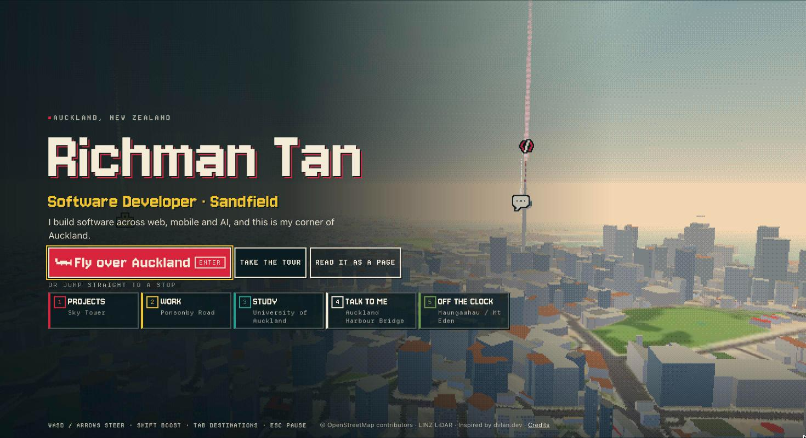
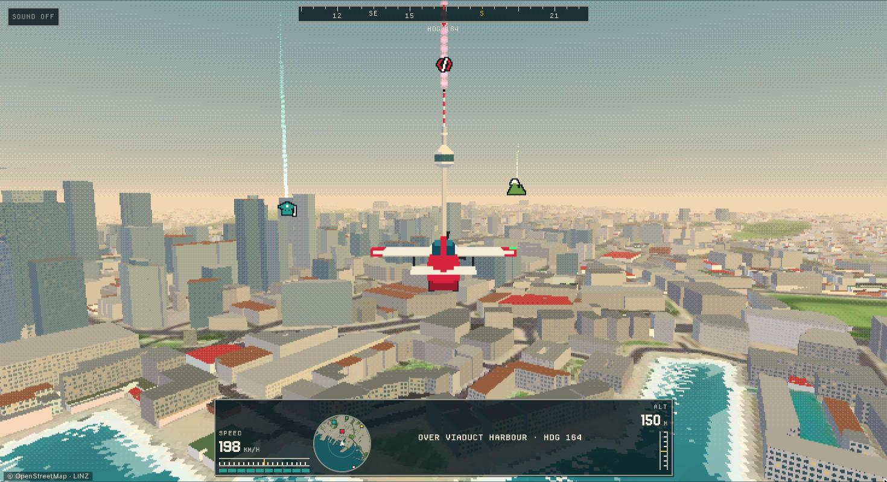
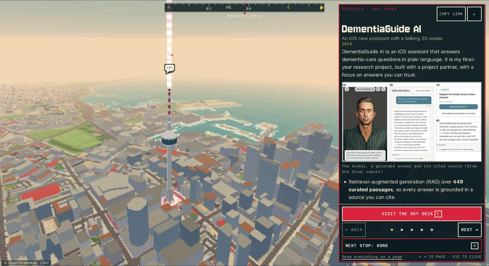
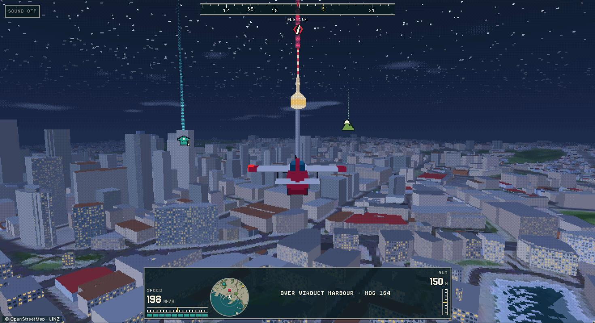
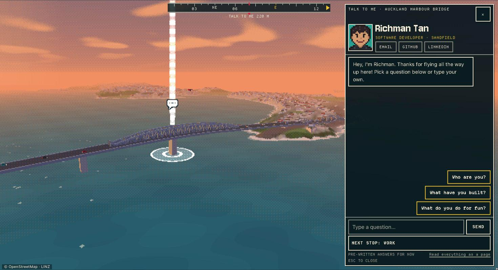
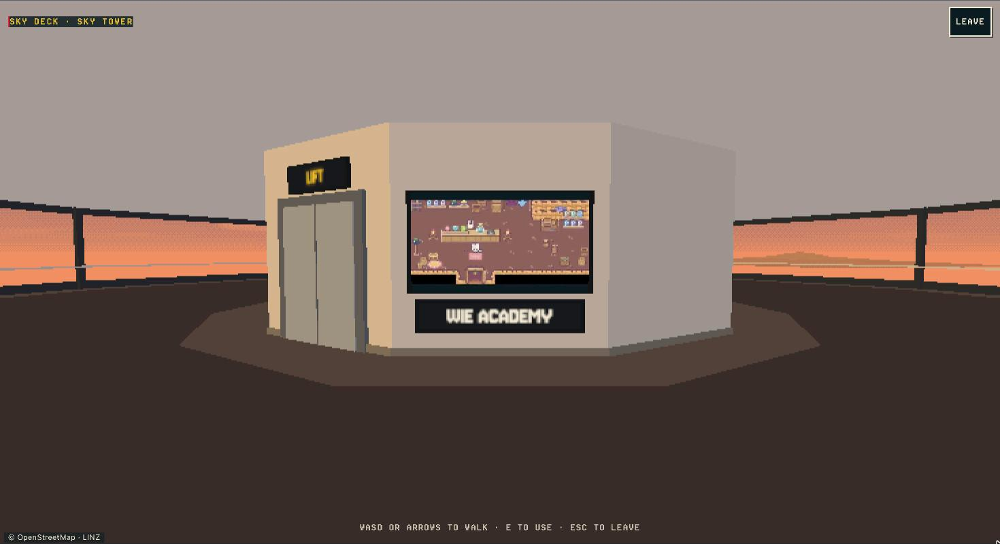

# auckland-world

[](https://github.com/Richman-Tan/auckland-world/actions/workflows/ci.yml)
[](https://github.com/Richman-Tan/auckland-world/releases)

**Live at [richmantan.vercel.app](https://richmantan.vercel.app/).** Richman Tan's portfolio as a little flight over real central Auckland. Fly a pixel plane to the beacons for projects, work, study and the rest, land inside the Sky Tower, chat on the Harbour Bridge, or read it all as a plain page at [`/page/`](https://richmantan.vercel.app/page/).

[](https://richmantan.vercel.app/)

The city is real: about 33,000 buildings from OpenStreetMap on terrain from LINZ's 1 m LiDAR survey, 7.2 by 8 km, packed into about 2 MB of map data and drawn at low resolution with dithered, toon-stepped shaders. There is no framework and no game engine, just TypeScript, [three.js](https://threejs.org/) and Vite. The title screen is interactive after 35 KB of gzipped JavaScript; three.js and the map load behind it.

Concept inspired by [dvlan.dev](https://dvlan.dev). All code, art and copy here are original.

## What you can do

- **Fly.** A small flight model with boost, a chase camera, a cockpit HUD with radar and compass, and collisions with every building, the Sky Tower and the Harbour Bridge.
- **Take the tour.** One button flies you to each of the five stops in turn on autopilot. Stops you have seen are remembered and ticked off.
- **Read.** Each stop opens a paged briefing beside its landmark. Every stop, page and room has its own link, and the browser's Back button works.
- **Land.** At the Sky Tower you can walk around the Sky Deck, where screens play short clips of each project.
- **Talk.** The stop on the Harbour Bridge is a chat: scripted answers for the suggested questions, Claude for anything you type, grounded only in the site's own content.
- **Watch the city.** The light follows the real time of day in Auckland. At night the windows come on and the Sky Tower is floodlit. Ferries cross the harbour and traffic runs over the bridge.
- **Or skip all of it.** [`/page/`](https://richmantan.vercel.app/page/) is the same content as one static page with no JavaScript, and it is where you land without WebGL.

<table>
<tr>
<td width="50%"><br><sub>Over the Viaduct, heading for the Sky Tower.</sub></td>
<td width="50%"><br><sub>A briefing opens beside its landmark while the plane holds a circle.</sub></td>
</tr>
<tr>
<td><br><sub>Night, on the real Auckland clock or with <code>?time=night</code>.</sub></td>
<td><br><sub>The chat on the Harbour Bridge at dusk, with traffic on the deck.</sub></td>
</tr>
<tr>
<td><br><sub>Inside the Sky Deck. The windows look out on the same city.</sub></td>
<td><br><sub>The destinations map, with the stops already seen ticked off.</sub></td>
</tr>
</table>

## Controls

| | Keyboard | Gamepad | Touch |
|---|---|---|---|
| Steer and pitch | W A S D or arrows, or drag with the mouse | Left stick | Stick, bottom left |
| Boost | Shift | RT or RB | BOOST |
| Read or talk at a beacon | Space | A | READ, or the prompt |
| Land at the Sky Tower, use what you face | E | X | The prompt |
| Destinations map | Tab or M | Y | MAP |
| Pick a stop, then fly there | 1 to 5, then Enter | D-pad, then A | Tap it twice |
| Page through a briefing | Left and right, or A and D | D-pad | Buttons |
| Next stop, from a briefing | N | LB | Button |
| Back | Esc | B | Buttons |
| Pause menu and settings | Esc while flying | Start | MENU |

The settings (graphics, time of day, sound, pitch direction, reduced motion) are in the pause menu.

## Links and parameters

| Address | Opens |
|---|---|
| `/?stop=projects` | A stop's briefing. Stops: `projects`, `work`, `study`, `talk`, `offclock`. |
| `/?stop=projects&page=wie-academy` | One page of it. |
| `/?stop=projects&room=skydeck` | Inside the Sky Deck. |
| `/?time=dusk` | A time of day: `morning`, `afternoon`, `dusk`, `night`, or a solar hour such as `22`. |
| `/?quality=low` | The lighter map tier (`low` or `high`) for this visit. |
| `/?map=fake` | The synthetic test map instead of Auckland. |
| `/?debug` | `window.__aw`: state, teleports, frame statistics. |

## Run it

```sh
nvm use               # Node 22
npm install
npm run dev           # http://localhost:5173
npm run typecheck     # src, scripts, api and the dev harnesses
npm test              # about 300 tests, a few seconds
npm run build         # typecheck, then vite build (this is what Vercel runs)
npm run check:bundle  # after a build: the title page and /page/ load no three.js up front, and stay in budget
```

`npm run dev` has no chat API, so the chat is scripted locally. The built map is committed in `public/map/`, so nothing needs fetching to run the site. To rebuild it:

```sh
npm run map:fake   # the synthetic world in public/map-fake (no network)
npm run map        # fetch (cached in data/), build public/map, check
```

## Testing and deploying

GitHub Actions (`.github/workflows/ci.yml`) runs the typecheck, the tests, a build and the bundle check on every push to `master` and every pull request. The tests are plain Vitest in Node: the flight model, the autopilot flown headless to every stop on the real map, the state machine, routing, the content rules, the chat server and the map pipeline. There are no browser tests; the dev harnesses in `dev/*.html` are for looking at things by hand.

The Vercel project is not connected to this repository, so a push does not deploy. Deploy from a clean checkout of `master`:

```sh
vercel --prod
```

Set `ANTHROPIC_API_KEY` in the Vercel project for the AI chat; without it the chat stays scripted.

## How it works

`docs/PLAN.md` is the original design and milestones, kept as a record. This README describes the code as it is. `ATTRIBUTION.md` has the data licences.

### Layout

- `src/app/` state machine, contracts, stop placement, routing, progress, settings, the frame-rate governor and the app loop (`app.ts`)
- `src/world/`, `src/render/` map loading, worker extrusion, low-res renderer, terrain, water, landmarks, beacons, ambient traffic
- `src/audio/` the synthesised sound, loaded on demand
- `src/flight/`, `src/input/` flight model, autopilot, orbit, proximity, chase camera, plane, keyboard, mouse, touch and gamepad
- `src/ui/` title, HUD, nav, briefing, chat, warp, pause and error views
- `src/room/` the Sky Deck: layout and hotspots, walking, and the runtime (screens, signs, first-person camera); the room's mesh is `src/world/landmarks/skyDeck.ts`
- `src/chat/` bridge chat: scripted matching, the AI backend (`remote.ts`), the `/api/chat` handler and its system prompt
- `api/chat.ts` Vercel Node.js function for the AI chat; `api/_site.ts` is its generated prompt (`npm run chat:site`)
- `src/content/` everything the site says (one source for the 3D view, `/page/` and the chat prompt)
- `src/shared/` binary map formats, collision, palette, time of day, detail ladder and ambient paths (pure; shared by the pipeline, the runtime and the tests)
- `scripts/` map pipeline (fetch, build, check) and the synthetic map generator
- `dev/*.html` dev-only harnesses for the world, flight, UI and the social card (`dev/og.html`)

### Tour, progress and links

- **Tour.** "Take the tour" on the title screen loads the world and flies to the first stop on autopilot. Every briefing and the chat then offer "Next stop" (N in a briefing), which flies to the next stop not yet seen, in `TOUR_ORDER` (`src/app/progress.ts`), ending at the chat.
- **Progress.** Opening a stop's briefing, chat or room marks it seen. The set is kept in `localStorage` (`aw:progress:v1`) and shown as ticks on the title and the destinations map; the site works the same with storage blocked.
- **Links.** The address follows what is open (`src/app/route.ts`). Moving to another stop adds a history entry and a page turn rewrites the current one, so the browser's Back and Forward walk the visit a stop at a time (cutting to the stop rather than flying). "Copy link" in a briefing copies the address, and without WebGL the same link leads to that spot on `/page/`.

### A living city

- **Time of day** (`src/shared/timeOfDay.ts`). The sky, the three steps of light, fog, water, window lights and stars all come from one `Look`, blended between keyframes on a solar clock where 6 is sunrise, 12 noon and 18 sunset. On Auto the real wall-clock time in Auckland is mapped onto that clock using the day's sunrise and sunset, so it is light at 8 pm in December and dark by 6 in June. The settings can pin Morning, Afternoon, Dusk or Night, and `?time=` takes a solar hour or one of those names. Afternoon is the look the site was first drawn in, and a test holds it to those colours.
- **At night** about half of each tower's windows are lit, the Sky Tower's pod and mast are floodlit (faces marked with `ALPHA_FLOOD` or `ALPHA_WINDOW` in `src/world/landmarks/builder.ts`), the Sky Deck is lit from inside, and traffic shows head and tail lights.
- **Ambient traffic** (`src/world/ambient.ts`, paths in `src/shared/ambientPaths.ts`): ferries on the Devonport and Bayswater runs, a boat that passes under the Harbour Bridge's main span, and cars on the bridge keeping left. Two instanced meshes, so two draw calls. A ferry route is only used if every point along it is over water on the loaded map, which is why the synthetic map gets no boats sailing over land. None of it can be hit.
- **Sound** (`src/audio/index.ts`) is off until switched on, from the HUD or the settings. It is synthesised with Web Audio (an engine note and wind that follow the airspeed, a room hum on the Sky Deck, a few short cues), so there are no audio files; the module is its own chunk, fetched on first use.
- `dev/world.html?map=real&view=bridge&time=18` previews any hour; `[` and `]` scrub half an hour at a time.

### Settings and performance

- **Settings** live in the pause menu (Esc) and are kept in `localStorage` (`aw:settings:v1`, `src/app/settings.ts`): graphics (Auto, Sharp, Fast), time of day, sound, which way W or stick-up pitches, and reduced motion.
- **Two kinds of quality.** The tier (`high` or `low`) decides what is loaded: the ground texture, and whether small buildings are built. It is picked once per visit from `?quality=`, else a pinned graphics setting, else the device (touch or four cores and under means low). Detail is adjusted while running, on a ladder in `src/shared/detail.ts`: first a shorter draw distance, then coarser 3D pixels. The HUD keeps its size throughout, because only the canvas changes scale.
- **The governor** (`src/app/governor.ts`) drives that ladder when graphics is Auto. It steps down after about three seconds under 45 fps, tries stepping back up after twelve clean seconds, settles on the lower level if that brings the stutter back, and gives the detail back entirely if lowering it made frames no faster (a 30 Hz power-saving mode, say). `window.__aw.info().detail` shows the level.
- **Budgets.** At most 60 draw calls and 700,000 triangles in view (about 47 and 585,000 over the CBD), a 250 KB gzip ceiling on the title page's JavaScript with no three.js in it, and 3 MB of map data. `npm run check:bundle` and `npm run map:check` enforce the last two.
- **Reduced motion** (the device preference, or the setting): the title backdrop and the briefing camera hold still, the view does not roll with the bank, and "Fly me there" cuts to the stop instead of time-warping across the city.
- **Idle.** Under the pause menu the scene is drawn twice and then left alone until something changes.
- **Touch.** The stick and buttons show only while flying or walking, each action in the approach prompt is its own button, and MENU (top left) opens the pause menu and settings, which have no other way in without a keyboard. The touch layout is driven by `(pointer: coarse)` media queries, so a narrow desktop window does not show it.

### Search and sharing

The flight is a canvas, so what a crawler or a script-less browser needs is put there at build time by `scripts/vite/pagePrerender.ts`, from the same content as everything else:

- `index.html` gets a summary inside `<noscript>`: who this is, and a link to every stop on `/page/`.
- Both pages get schema.org data (a `Person` and a `WebSite`) in the head. It carries only what the site already says, and no contact address.
- `public/sitemap.xml` lists the two pages and `public/robots.txt` points at it and keeps crawlers off `/api/`.

The site's address is `SITE_URL` in `src/content/links.ts`; a test checks that the canonical links, the sitemap and `robots.txt` all agree with it.

### Keyboard focus and recovery

While flying, the input layer owns the keys (`src/input/core.ts`). In any dialog (title, map, briefing, pause) Tab belongs to the browser so focus can move between the buttons, M still toggles the map, and Enter or Space on a focused button only activates that button.

If the browser drops the WebGL context, a notice shows while it recovers; if it does not come back within five seconds the error screen offers a reload and the plain page. `window.__aw.loseContext()` and `restoreContext()` simulate it.

### Bridge chat

Suggested questions and job-hunting questions are always answered from `src/content/chat.ts`. Typed questions go to `POST /api/chat`, which asks Claude Haiku 5.5 using a system prompt built only from the site's content (`src/chat/prompt.ts`, generated into `api/_site.ts` by `npm run chat:site`; a test fails if it is stale, so rerun it after editing content). If the endpoint is off, rate limited or failing, the chat quietly falls back to the scripted answers, and the panel says which mode it is in.

- Without `ANTHROPIC_API_KEY`, `GET /api/chat` reports `{ "enabled": false }` and everything stays scripted.
- The hard cost cap is the monthly spend limit on the Anthropic account. The handler also limits each visitor (12 questions per 10 minutes) and each instance (400 per hour), and caps answers at 1024 tokens.
- Vercel logs one line per answer with token usage only; visitor text is never logged.

### Sky Deck

Near the Sky Tower (or from the projects briefing) press E to land inside the pod. Walk with the flight controls; the screens on the core play short muted loops from `public/media/skydeck/`, and facing one shows a prompt that opens that project's briefing page beside it. Esc closes the page, Esc again (or the lift, or Leave) puts you back in the plane on the holding circle.

- Screens, their pages and videos are listed in `SKY_DECK_SPOTS` (`src/room/layout.ts`); a test checks each one points at a real projects page.
- Nothing for the room is downloaded until the first visit.

### Map pipeline

`npm run map` = `map:fetch` (cached in `$AW_DATA_DIR`, default `./data`; a second run makes 0 network requests; `-- --only=osm|linz`, `--refresh`) then `map:build` (`-- --stage=water,terrain,landmarks,places,buildings,ground,minimap,meta`) then `map:check`. Outputs go to `public/map/`; the report and debug PNGs (water, hillshade, heights, height-sources) go to `$AW_DATA_DIR/work/`.

- Sources: OpenStreetMap via Overpass (three endpoints, 2 s spacing, 5/15/45 s backoff, 2x2 split on timeout) and the LINZ Auckland 2024 LiDAR 1 m DEM and DSM (public S3, checksum-verified against the STAC `file:checksum` multihash). Tiles that merely touch the world rectangle are not fetched.
- **LERC decode path:** the LINZ tiles are Float32 COGs with TIFF compression 34887 (LERC). `geotiff@2.1.3`'s built-in LERC decoder reads them directly (`GeoTIFF.fromFile` + `readRasters` on a window), so the `lerc@4` WASM fallback and GDAL were not needed. Spike check: `BA32_10000_0401` decodes in about 1 s with max 195.743 and mean 21.919, matching its header statistics. `scripts/build/mosaic.ts` reads each tile in 1024-row strips into one 7200 x 8000 Float32 mosaic per kind (nodata becomes NaN); nothing at full resolution is written to disk.
- `osmtogeojson` is not used; multipolygons are assembled in `scripts/lib/geom.ts` (`assembleRings`).

## Licence and credits

© 2026 Richman Tan, all rights reserved: the code, art and copy are public to be read, not reused. See [`LICENSE`](LICENSE). The map data and fonts are third-party and keep their own open licences.

Map data © [OpenStreetMap](https://www.openstreetmap.org/copyright) contributors (ODbL). Elevation and building heights from the Auckland LiDAR 1 m DEM and DSM (2024), Toitū Te Whenua LINZ (CC BY 4.0). Fonts: Jersey 10 and Departure Mono (SIL OFL 1.1). Details are in [`ATTRIBUTION.md`](ATTRIBUTION.md). The idea of a portfolio you fly over comes from [dvlan.dev](https://dvlan.dev).
